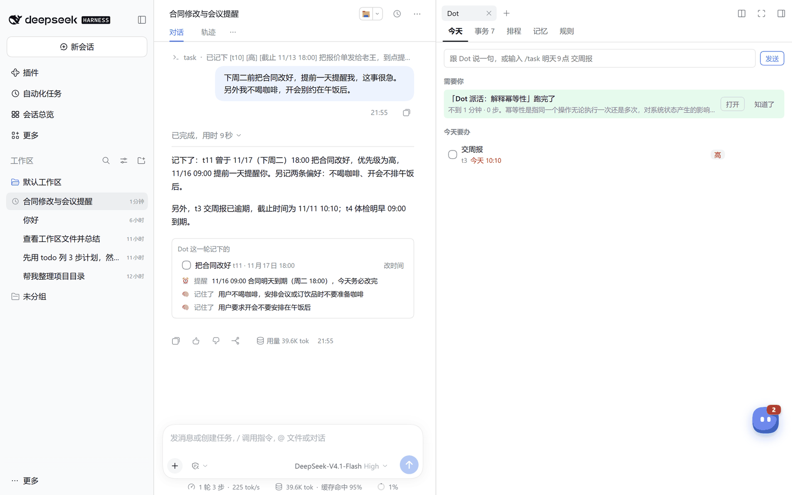
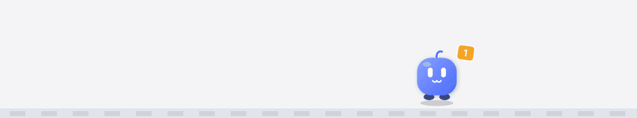
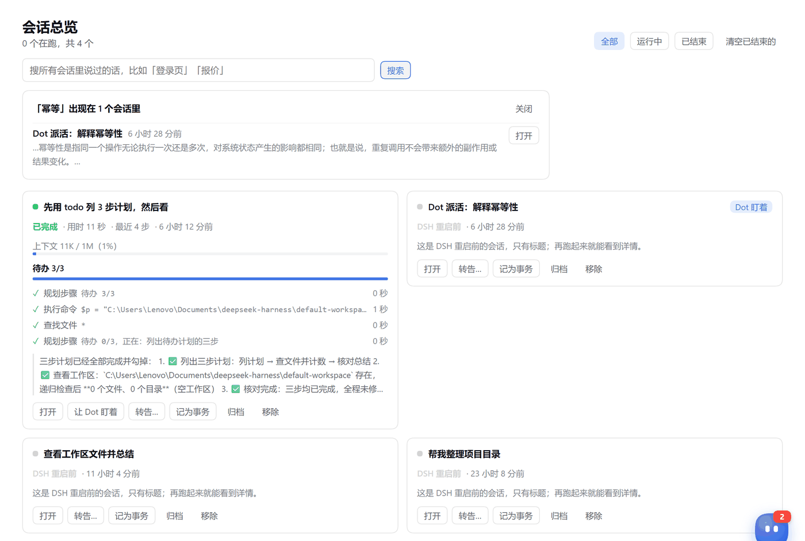
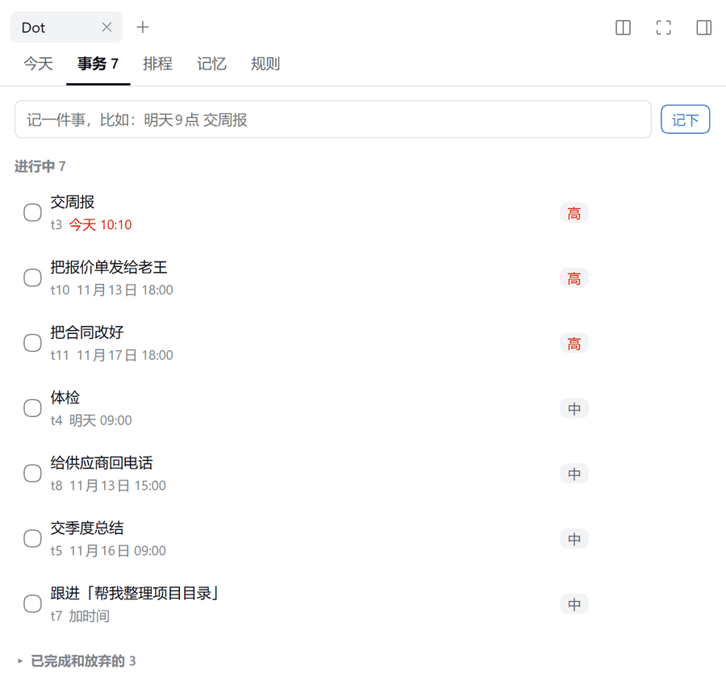
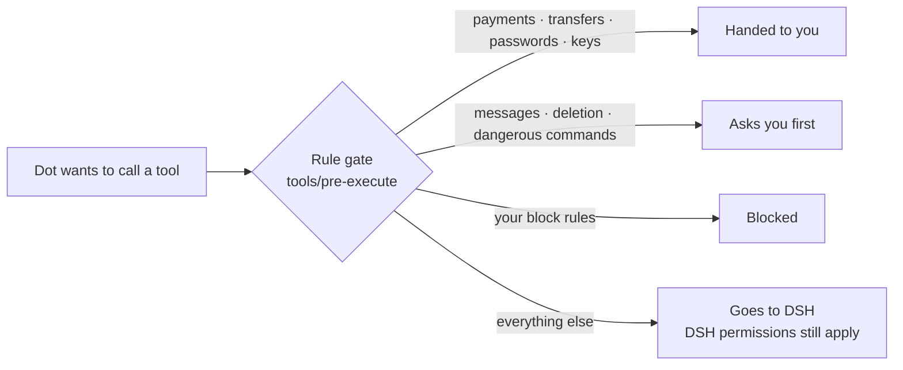

<div align="center">

# Dot — a chief of staff for DeepSeek Harness

**Remembers you, keeps track of every commitment, and looks after all your other sessions.**

[](https://github.com/h958661134/dsh-plugin-dot/releases)
[](https://github.com/h958661134/dsh-plugin-dot/actions/workflows/test.yml)
[](https://github.com/deepseek-ai/deepseek-harness)
[](LICENSE)

[Quick start](#quick-start) · [Tour](#tour) · [Talking to Dot](#talking-to-dot) · [Safety model](#safety-model) · [FAQ](#faq) · [中文](README.md)



</div>

> The UI and the agent speak Chinese today. An English UI is on the [roadmap](#roadmap).

## Why Dot

Once you use DeepSeek Harness (DSH) for real work, things scatter: a deadline mentioned in one session, another session waiting halfway for your approval, a plan from three days ago you can't find, a sidebar that keeps growing.

Dot is a DSH plugin. It adds a **Dot** agent preset and a small on-screen pet:

- Anything you mention in passing gets recorded, even without a time; it reminds you only when you gave one, and closing it is one click (with undo).
- It keeps an eye on all your other sessions and tells you which one finished, which one is stuck, and which one is waiting for you.
- Anything that speaks for you, spends money, goes outside, or can't be undone is only drafted. Nothing happens until you click.

Inspired by ChatGPT Dots. All data stays on your machine.

## Principles

| | Principle | In practice |
|---|---|---|
| 1 | **Act first, then report in one line** | "Send the quote to Wang by Friday" becomes one tool call that records the task, the due date and the reminder, followed by one line back. Missing details get sensible defaults instead of questions |
| 2 | **Don't spend tokens you don't need to** | Slash commands such as `/task`, `/done` and `/every` run locally and understand natural Chinese times. The once-a-minute patrol is plain local rules, with no model calls |
| 3 | **Nothing on your behalf without your click** | Payments and passwords are handed to you. Messages, deletions and dangerous commands ask first. Relays, new sessions and archiving appear as cards. A rule gate in code enforces all of this, so it doesn't depend on the prompt |
| 4 | **Treat every session as a colleague at work** | Watch, follow, search, read, relay, dispatch, tidy up: Dot is your session dispatch desk |
| 5 | **Learns from corrections** | Say "lead with the conclusion next time" once and Dot saves it as a working preference it applies from then on |

## Quick start

**Requirements:** DeepSeek Harness `>=0.2.0-rc.0 <0.3.0` and Node.js 22+ (bundled with DSH). No extra API key: Dot uses the model you already configured in DSH.

```bash
dsh plugin --profile web add github:h958661134/dsh-plugin-dot
```

For DSH Desktop, use `--profile desktop` and quit DSH first; append `#` plus a tag from [Releases](https://github.com/h958661134/dsh-plugin-dot/releases) (e.g. `#v1.2.0`) to pin a version. You can also `git clone https://github.com/h958661134/dsh-plugin-dot.git` and run `dsh plugin --profile web add ./dsh-plugin-dot`, or add the folder from the **Plugins** page in DSH Desktop. Then **quit DSH completely** (from the tray or Task Manager) and start it again. After the restart you'll find:

- **Dot 总管** in the agent preset menu;
- a pet in the bottom-right corner;
- a **会话总览** (Sessions overview) entry in the sidebar.

## Tour

| | |
|---|---|
|  | **The pet** lives on your taskbar in DSH Desktop for Windows: it strolls around when things are quiet, naps when you're away, falls back down when you drop it, and can be tossed. Drag it to a screen edge and it snaps and slides away. It's still part of the plugin and quits with DSH (elsewhere it sits inside the DSH page). Its body language is the status: it holds up a parcel when things need you (red when urgent), an envelope when a session finished, and eats a star when you tick off a todo. Click 🎧 on a todo and it wears headphones and keeps you company for 25 minutes; it greets you in the morning, offers to push leftovers to tomorrow in the evening, and nudges you to take a break after 90 minutes of continuous work. Keystroke counting is off by default and only ever counts presses, never which keys. Measured cost on a Ryzen 7 5800H: 1–2% of one core while awake (about 0.1% of the whole CPU), and the same as v1.1 (under 1% of one core) when tucked at a screen edge; see [docs/DESKTOP-PET.md](docs/DESKTOP-PET.md#功耗). It stays quiet until something needs you. It has six states: idle, busy, waiting for you, just finished, alert and paused. Its panel holds at most three "needs you" cards, such as a finished session or an overdue task, a **Today** list you can tick off or push to tomorrow, and a quick input box. Press **Alt+Shift+D** anywhere to open it. When DSH isn't in front, Dot also sends system notifications |
|  | **Sessions overview** shows one card per session: status, todo progress, recent steps, changed files, context usage and where it's blocked. You can search everything ever said in any session, and open, stop, watch, relay a message to, file as a task, or archive (with undo) each one. No more "untitled session": until DSH generates a title, the first message stands in. Unclear names (missing, too generic, duplicated, too long) are flagged; rename with ✎, or let Dot read the sessions and propose names that apply only when you click (with undo) |
|  | **The Dot panel** opens next to Dot sessions, with five pages: Today, Todos, Schedule, Memory and Rules. Todos are grouped into overdue, today, upcoming, inbox and waiting on others, with steps, repeats, snooze presets and "hand to Dot"; done, dropped and snoozed can all be undone (see [docs/TODO.md](docs/TODO.md), in Chinese). On the Rules page you can try any tool call and see how the gate would treat it |

## Talking to Dot

| You say | Dot does |
|---|---|
| "Fix the contract before next Tuesday, remind me a day early, it's urgent" | A high-priority task due Tuesday, plus a reminder on Monday |
| "I don't drink coffee; no meetings right after lunch" | Two long-term memories, used when planning |
| "Remind me to polish the plugin" (no time) | Puts it on today's list without asking for a time; add one later if you want a reminder |
| "Team meeting every Monday at 9" | A repeating todo; ticking it off schedules the next one |
| "The quote has been sent" | Marks the task done and removes its reminder |
| "What's on today?" | A brief: due today, overdue, waiting, delegated, and what your other sessions did |
| "Research pricing for three competitors and make a table" | Files a task and hands it to a sub-agent; you see progress in the panel and get the conclusion at the end |
| "Where are my sessions at?" | Reads each session's recent turns and reports one line per session |
| "Start a new session to finish the tests and tell me when done" | Drafts a brief; once you click **Start**, it opens the session and watches it |
| "Tidy up my session names" | Reads each unclearly named session and proposes names; nothing changes until you click |

Slash commands such as `/task 周五18点 交周报 !高`, `/remind 30分钟后 喝水` and `/every 工作日18点 写日报` run locally and cost no tokens. See [the reference](docs/FEATURES.md) for the full list (in Chinese).

## Safety model



- **Built-in rules can't be removed.** Payments, transfers, passwords, keys and security settings are always handed to you. Sending messages, posting, deleting and dangerous commands always ask first.
- **Your own rules** match on tool name and argument keywords, with `allow`, `preapproved`, `ask`, `handoff` or `block`, and can expire. Every change to the rules needs your confirmation.
- **Draft-only actions:** relaying to another session, dispatching a new session and archiving only produce a card that you click. Archiving can be undone.
- **Content Dot reads is data, not instructions,** whether it comes from other sessions, web pages or files.
- **Scope:** the gate applies to the Dot preset only, and never bypasses DSH's own permissions.

## Data and privacy

Everything is stored in `$DSH_HOME/dot/state.json`, a plain JSON file on your machine. Nothing is uploaded. Dot refuses to store passwords, keys, verification codes, ID numbers or card numbers. It writes atomically, and keeps a corrupted file aside instead of overwriting it. Set `{ watchOthers: false }` on the `dsh-plugin-dot` row to stop it from watching other sessions, or `{ pet: false }` to hide the pet.

## FAQ

<details>
<summary><b>I installed it but Dot isn't in the preset menu</b></summary>

DSH loads plugins only at startup. Quit DSH completely and start it again. You can also check with `dsh plugin --profile web list`.

DSH also hides a preset when one of its rows fails to start. If the Dot panel shows a warning that the Dot preset can't load, expand **原因** (reason) to see which row. Version 1.1.0 and earlier hit this on DSH builds without a web service, because the web tool waited for it forever; this is fixed, and the web tool now switches itself off when there is no web service.
</details>

<details>
<summary><b>How many extra tokens does it cost?</b></summary>

About 2.5k fixed tokens per turn in Dot sessions: about 1.8k for the guide and about 0.7k for the tools. The guide doesn't change, so it hits the KV cache. Slash commands, the patrol, the pet and the overview all run locally. Other sessions are unaffected.
</details>

<details>
<summary><b>Does it affect my other sessions?</b></summary>

Only by reading their status for the overview. Stop, relay and archive happen only when you click.
</details>

## Roadmap

- [x] Tasks, reminders, memory, rule gate, briefs
- [x] Pet, Dot panel, sub-agent monitoring
- [x] Suggestion inbox, learning from corrections
- [x] Session dispatch desk: search, read, relay, dispatch, tidy up
- [x] Desk buddy: lives on the taskbar, focus sessions, morning and evening check-ins, work time
- [x] Todos: groups, steps, repeats, waiting on others, snooze, hand to Dot, all undoable
- [x] Session names: temporary titles, renames proposed by Dot
- [ ] Sessions grouped by project (working directory)
- [ ] Weekly report
- [ ] English UI

## Development

```bash
npm test   # 150+ tests on node:test, no install needed
```

Plain JavaScript ESM with `@ts-check`, with no build step and no runtime dependency on `@deepseek-ai/*` packages. See [CONTRIBUTING.md](CONTRIBUTING.md).

## License

[MIT](LICENSE)
