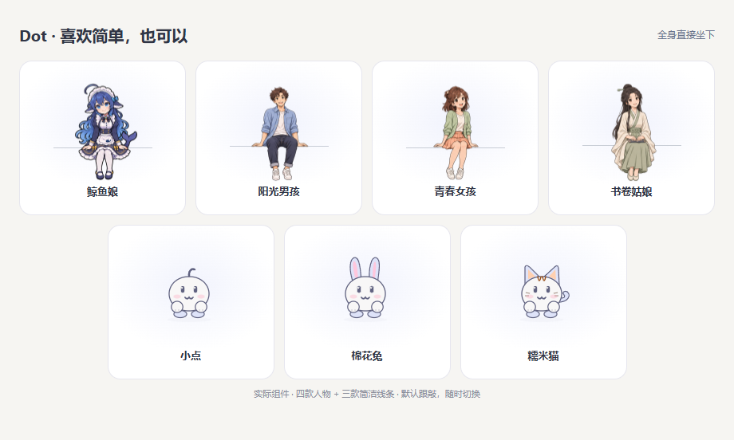
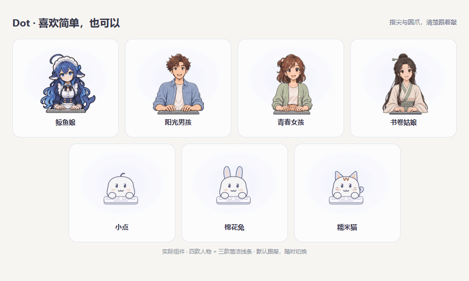
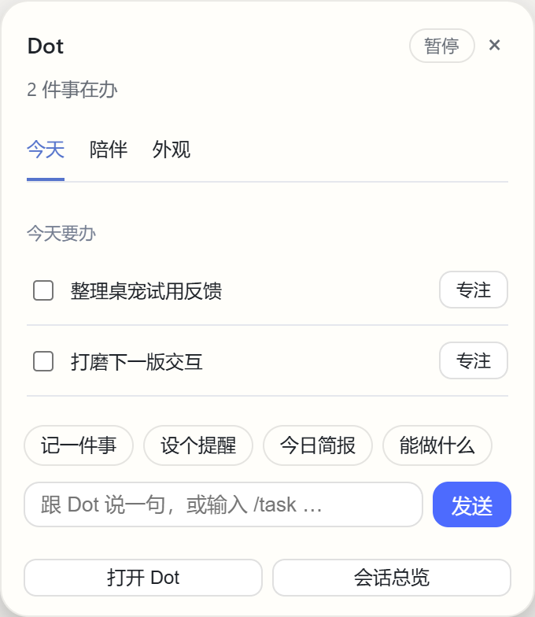
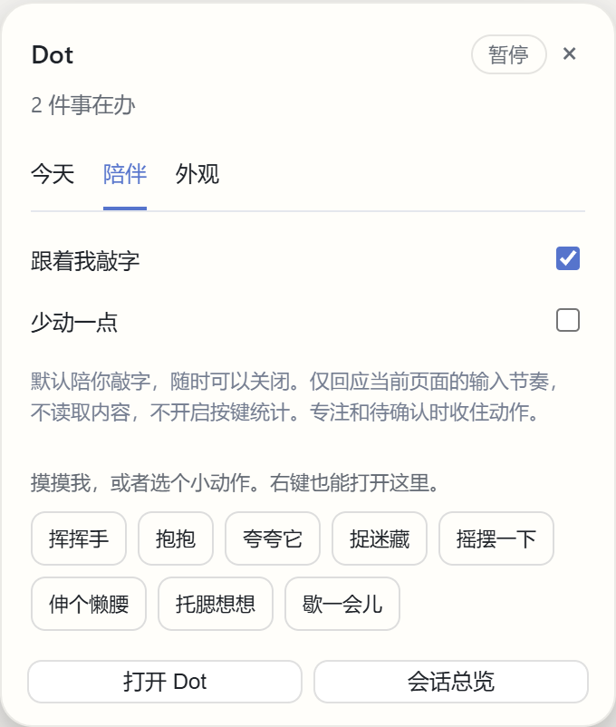
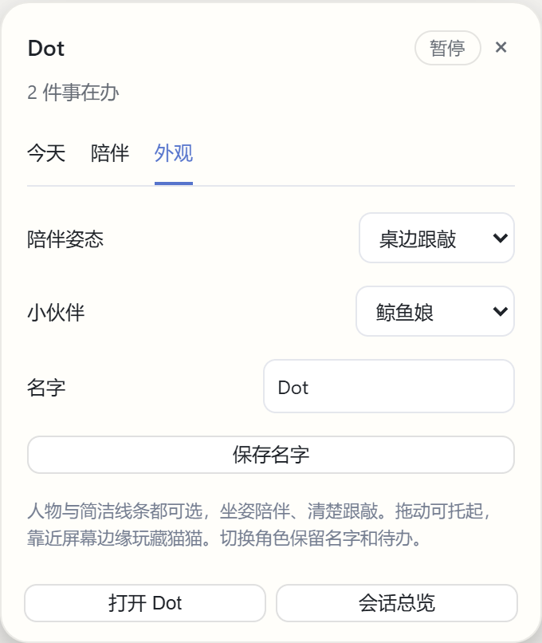
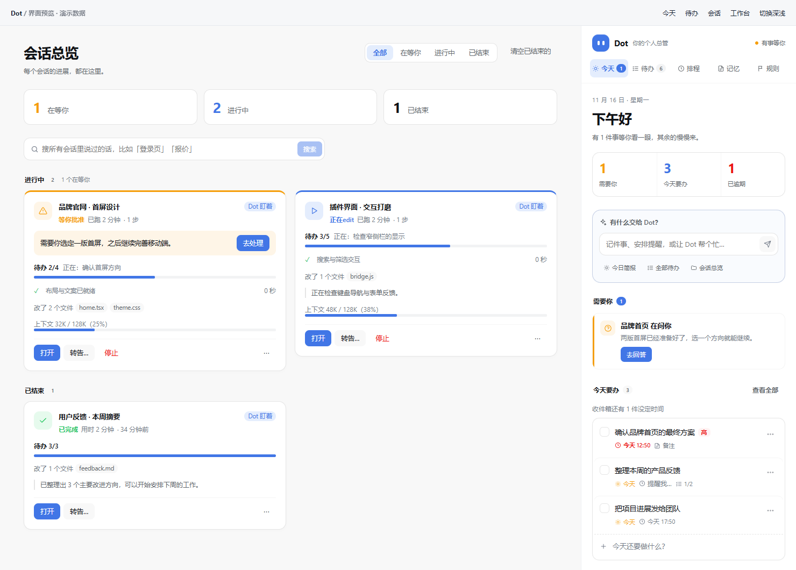
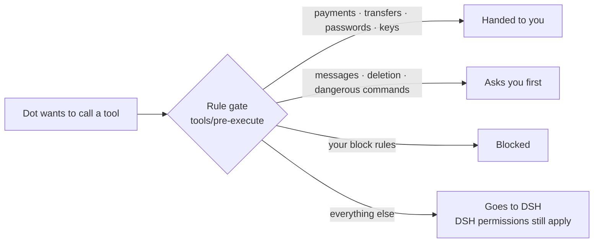

<div align="center">

# Dot — a chief of staff for DeepSeek Harness

**Keeps your tasks and sessions in view, and keeps you company while you type.**

[](https://github.com/h958661134/dsh-plugin-dot/releases)
[](https://github.com/h958661134/dsh-plugin-dot/actions/workflows/test.yml)
[](https://github.com/deepseek-ai/deepseek-harness)
[](LICENSE)

[Quick start](#quick-start) · [Seven companions](#seven-companions) · [Interactions](#interactions) · [Tour](#tour) · [Talking to Dot](#talking-to-dot) · [Safety model](#safety-model) · [FAQ](#faq) · [中文](README.md)



</div>

**v1.5.0 is available:** [release notes and download](https://github.com/h958661134/dsh-plugin-dot/releases/tag/v1.5.0). Four illustrated characters and three simple line companions, with typing responses enabled by default, seated poses, quiet idle gestures and edge peekaboo.

> The UI and the agent speak Chinese today. An English UI is on the [roadmap](#roadmap).

## Why Dot

Once you use DeepSeek Harness (DSH) for real work, things scatter: a deadline mentioned in one session, another session waiting halfway for your approval, a plan from three days ago you can't find, a sidebar that keeps growing.

Dot is a DSH plugin. It adds a **Dot** agent preset and a small on-screen pet:

- Anything you mention in passing gets recorded, even without a time; it reminds you only when you gave one, and closing it is one click (with undo).
- It keeps an eye on all your other sessions and tells you which one finished, which one is stuck, and which one is waiting for you.
- Anything that speaks for you, spends money, goes outside, or can't be undone is only drafted. Nothing happens until you click.

Inspired by ChatGPT Dots. All data stays on your machine.

## Principles

| | Principle | In practice |
|---|---|---|
| 1 | **Act first, then report in one line** | "Send the quote to Wang by Friday" becomes one tool call that records the task, the due date and the reminder, followed by one line back. Missing details get sensible defaults instead of questions |
| 2 | **Don't spend tokens you don't need to** | Slash commands such as `/task`, `/done` and `/every` run locally and understand natural Chinese times. The once-a-minute patrol is plain local rules, with no model calls |
| 3 | **Nothing on your behalf without your click** | Payments and passwords are handed to you. Messages, deletions and dangerous commands ask first. Relays, new sessions and archiving appear as cards. A rule gate in code enforces all of this, so it doesn't depend on the prompt |
| 4 | **Treat every session as a colleague at work** | Watch, follow, search, read, relay, dispatch, tidy up: Dot is your session dispatch desk |
| 5 | **Learns from corrections** | Say "lead with the conclusion next time" once and Dot saves it as a working preference it applies from then on |

## Quick start

**Requirements:** DeepSeek Harness `>=0.2.0-rc.0 <0.3.0` and Node.js 22+ (bundled with DSH). No extra API key: Dot uses the model you already configured in DSH.

Quit DSH completely, then choose the command for your profile:

```bash
# Windows desktop: a companion outside the DSH window
dsh plugin --profile desktop add github:h958661134/dsh-plugin-dot#v1.5.0

# Web: a companion inside the DSH page
dsh plugin --profile web add github:h958661134/dsh-plugin-dot#v1.5.0
```

**Use the same command to upgrade**, then restart DSH. Tasks, names and preferences are retained. The commands pin v1.5.0; omit the tag to follow the main branch. On Windows, the desktop CLI is in the installation directory at `resources/runtime/cli/bin/dsh.cmd`. You can also clone the repository and run `dsh plugin --profile web add ./dsh-plugin-dot`, or add the folder from the desktop **Plugins** page.

After restarting, you'll find:

- **Dot 总管** in the agent preset menu;
- a standalone companion on Windows Desktop, or a pet in the bottom-right corner of the DSH web page;
- a **会话总览** (Sessions overview) entry in the sidebar.

## Companions

### Seven companions

Click the pet, then open **外观 → 小伙伴** (Appearance → Companion). Illustrated characters use matching designs across desk and seated poses; the refined line style is available alongside them.

| Style | Companion | Look and personality |
|---|---|---|
| Illustrated | **Whale Maiden · 鲸鱼娘** | Blue and white, whale fins and a tail; gently swishes her tail and peeks from the screen edge |
| Illustrated | **Sunny Boy · 阳光男孩** | A blue-and-white shirt and an easy smile; occasionally stretches |
| Illustrated | **Youthful Girl · 青春女孩** | Chestnut hair and a mint cardigan; a cheerful wave or a quiet chin-rest |
| Illustrated | **Scholar · 书卷姑娘** | Understated hanfu and a book; turns a page and looks up |
| Simple line | **Dot · 小点** | A cream-colored round companion with fine outlines and little paws |
| Simple line | **Cotton Bunny · 棉花兔** | Long ears, round paws and a light cartoon silhouette |
| Simple line | **Mochi Cat · 糯米猫** | A round face, whiskers and a curled tail |

**Illustrated characters have fixed outfits and palettes.** Line companions support colors and accessories: scarf, leaf, cap, headphones, bow, crown, or none. Switching characters preserves your name, tasks, focus session and preferences. Whale Maiden is a derivative of a community character design; see the asset credits and license below.

### Interactions



<sub>Exported from the actual web renderer with demo data. The static image above shows the same seven characters without animation.</sub>

| What you do | How the companion responds |
|---|---|
| **Type at your desk** | Typing response is on by default. Hands alternate; illustrated fingers lift, press and rebound with a small keycap highlight. The body and keyboard stay steady, and the animation settles when you stop |
| **Choose a full-body pose** | Select **任务栏坐姿** (taskbar sitting) under Appearance → Pose. It sits immediately at the Windows taskbar or web page edge. Saved standing preferences now use this seated pose |
| **Pause for a moment** | Gentle breathing, blinking and an occasional chin-rest, plus tail swishes, stretches, waves or page turns |
| **Pick it up** | Drag it for a small suspended sway; release it to return to its companion pose |
| **Move it to a side edge** | It tucks away and peeks out with its head and hands. Hover to reveal it; click or drag it out to return |
| **Play for a moment** | Right-click for **陪伴** (Companionship), with wave, hug, praise, peekaboo, sway, stretch, chin-rest and rest actions. Illustrated characters map these to gestures available in their current pose |
| **Focus or keep things quiet** | Focus, rest, waiting for approval, pause and quiet mode take priority. **少动一点** (less motion) reduces companion animations |

**Typing response and keystroke statistics are separate controls.** The Windows desktop companion responds to system input rhythm; the web companion responds only inside the current DSH page. Typing response does not read key content or enable statistics. Counting stays off by default and records only totals. An explicit choice to disable typing response survives upgrades. Characters stay compact and no longer stroll automatically.

### Three quick-panel tabs

<table>
<tr><th>Today · 今天</th><th>Companionship · 陪伴</th><th>Appearance · 外观</th></tr>
<tr>
<td width="33%" valign="top"></td>
<td width="33%" valign="top"></td>
<td width="33%" valign="top"></td>
</tr>
</table>

<sub>Actual v1.5.0 web companion panels with demo data. Windows also provides these three tabs. The UI currently uses Chinese.</sub>

- **Today:** handle notifications, finish tasks, start or stop focus, and enter a message or slash command.
- **Companionship:** adjust typing response and motion, or trigger a small gesture.
- **Appearance:** choose desk or seated mode, switch character and change its name; line companions also offer colors and accessories.

Tasks, 25-minute focus sessions, morning and evening check-ins, work-time tracking, break reminders, sessions overview and notifications remain available. On Windows, **Alt+Shift+D** opens the pet panel; the pet starts and quits with DSH. There are no levels or daily streaks, and typing and idle animations use no model calls.

See the [companion guide](docs/DESK-BUDDY.md) and [character catalog](lib/pets/README.md) (in Chinese). Assets and motion settings are separate so more companions can be added or replaced.

## Tour



**Sessions overview** groups running, waiting and finished sessions. Each card shows status, task progress, recent steps, changed files and context usage. Search session history, open a session, stop or watch it, relay a message, file it as a task, or archive it with undo. Dot can also propose clearer names for your approval.

**The Dot panel** opens next to Dot sessions, with five pages: Today, Todos, Schedule, Memory and Rules. Today shows what needs you, today's tasks and optional suggestions. Todos support groups, steps, repeats, snooze, waiting on others and delegation; completing, dropping and snoozing can be undone. The Rules page lets you try a tool call to see how the gate treats it. See the [todo guide](docs/TODO.md) for details.

**In conversation**, one request can capture a task, reminder and preference. A receipt below the reply shows what was saved, with actions to complete a task or change its time.

## Talking to Dot

| You say | Dot does |
|---|---|
| "Fix the contract before next Tuesday, remind me a day early, it's urgent" | A high-priority task due Tuesday, plus a reminder on Monday |
| "I don't drink coffee; no meetings right after lunch" | Two long-term memories, used when planning |
| "Remind me to polish the plugin" (no time) | Puts it on today's list without asking for a time; add one later if you want a reminder |
| "Team meeting every Monday at 9" | A repeating todo; ticking it off schedules the next one |
| "The quote has been sent" | Marks the task done and removes its reminder |
| "What's on today?" | A brief: due today, overdue, waiting, delegated, and what your other sessions did |
| "Research pricing for three competitors and make a table" | Files a task and hands it to a sub-agent; you see progress in the panel and get the conclusion at the end |
| "Where are my sessions at?" | Reads each session's recent turns and reports one line per session |
| "Start a new session to finish the tests and tell me when done" | Drafts a brief; once you click **Start**, it opens the session and watches it |
| "Tidy up my session names" | Reads each unclearly named session and proposes names; nothing changes until you click |

Slash commands such as `/task 周五18点 交周报 !高`, `/remind 30分钟后 喝水` and `/every 工作日18点 写日报` run locally and cost no tokens. See [the reference](docs/FEATURES.md) for the full list (in Chinese).

## Safety model



- **Built-in rules can't be removed.** Payments, transfers, passwords, keys and security settings are always handed to you. Sending messages, posting, deleting and dangerous commands always ask first.
- **Your own rules** match on tool name and argument keywords, with `allow`, `preapproved`, `ask`, `handoff` or `block`, and can expire. Every change to the rules needs your confirmation.
- **Draft-only actions:** relaying to another session, dispatching a new session and archiving only produce a card that you click. Archiving can be undone.
- **Content Dot reads is data, not instructions,** whether it comes from other sessions, web pages or files.
- **Scope:** the gate applies to the Dot preset only, and never bypasses DSH's own permissions.

## Data and privacy

Everything is stored in `$DSH_HOME/dot/state.json`, a plain JSON file on your machine. Nothing is uploaded. Dot refuses to store passwords, keys, verification codes, ID numbers or card numbers. It writes atomically, and keeps a corrupted file aside instead of overwriting it. Set `{ watchOthers: false }` on the `dsh-plugin-dot` row to stop it from watching other sessions, or `{ pet: false }` to hide the pet.

## FAQ

<details>
<summary><b>Why doesn't it respond when I type in another app?</b></summary>

System-wide input response requires the standalone **Windows desktop companion**, installed into the desktop profile. The web pet responds only to the current DSH page. Choose **桌边跟敲** (desk typing) in Appearance and enable **跟着我敲字** in Companionship. Focus, rest, waiting, quiet and reduced-motion states can suppress typing animation.
</details>

<details>
<summary><b>Where is the standing pose, and why can't every character change outfits?</b></summary>

v1.5.0 replaces standing with a compact seated pose and removes automatic strolling. Illustrated characters use their own outfits and palettes. Switch to Dot, Cotton Bunny or Mochi Cat for color and accessory controls; existing preferences are retained.
</details>

<details>
<summary><b>I installed it but Dot isn't in the preset menu</b></summary>

DSH loads plugins only at startup. Quit DSH completely and start it again. You can also check with `dsh plugin --profile web list`.

DSH also hides a preset when one of its rows fails to start. If the Dot panel shows a warning that the Dot preset can't load, expand **原因** (reason) to see which row. Version 1.1.0 and earlier hit this on DSH builds without a web service, because the web tool waited for it forever; this is fixed, and the web tool now switches itself off when there is no web service.
</details>

<details>
<summary><b>How many extra tokens does it cost?</b></summary>

About 2.5k fixed tokens per turn in Dot sessions: about 1.8k for the guide and about 0.7k for the tools. The guide doesn't change, so it hits the KV cache. Slash commands, the patrol, the pet and the overview all run locally. Other sessions are unaffected.
</details>

<details>
<summary><b>Does it affect my other sessions?</b></summary>

Only by reading their status for the overview. Stop, relay and archive happen only when you click.
</details>

## Roadmap

- [x] Tasks, reminders, memory, rule gate, briefs
- [x] Pet, Dot panel, sub-agent monitoring
- [x] Suggestion inbox, learning from corrections
- [x] Session dispatch desk: search, read, relay, dispatch, tidy up
- [x] Desk buddy: taskbar sitting, focus sessions, morning and evening check-ins, work time
- [x] Seven companions in two styles: instant typing response, blinking, breathing, chin-rest, pickup and edge peekaboo
- [x] Today / Companionship / Appearance tabs and an extensible character catalog
- [x] Todos: groups, steps, repeats, waiting on others, snooze, hand to Dot, all undoable
- [x] Session names: temporary titles, renames proposed by Dot
- [ ] Sessions grouped by project (working directory)
- [ ] Weekly report
- [ ] English UI

## Development

```bash
npm test   # 201 tests on node:test, no install needed
```

Plain JavaScript ESM with `@ts-check`, with no build step and no runtime dependency on `@deepseek-ai/*` packages. See [CONTRIBUTING.md](CONTRIBUTING.md).

## License

Code is licensed under [MIT](LICENSE). Whale Maiden derivative assets use **CC BY-NC-SA 4.0**, based on 上善无形's community character 溟月 and ZipZipPipe's maid design. These assets are excluded from the code's MIT license. See [asset credits, licenses and generation records](lib/pets/assets/LICENSE.md).
