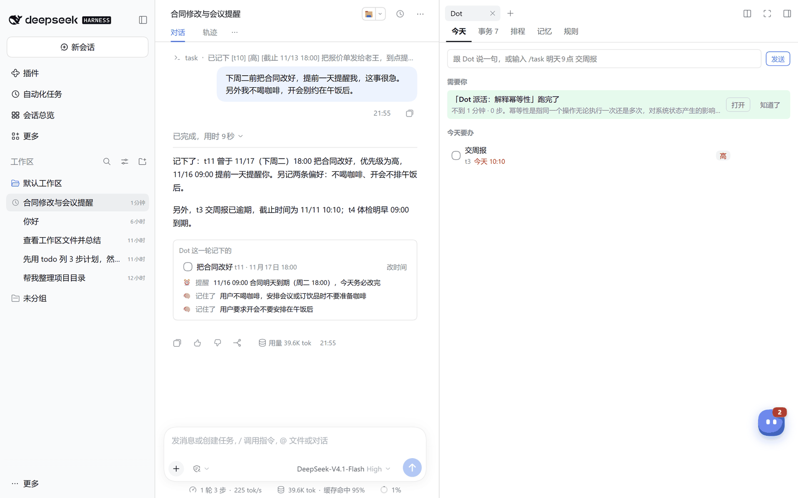
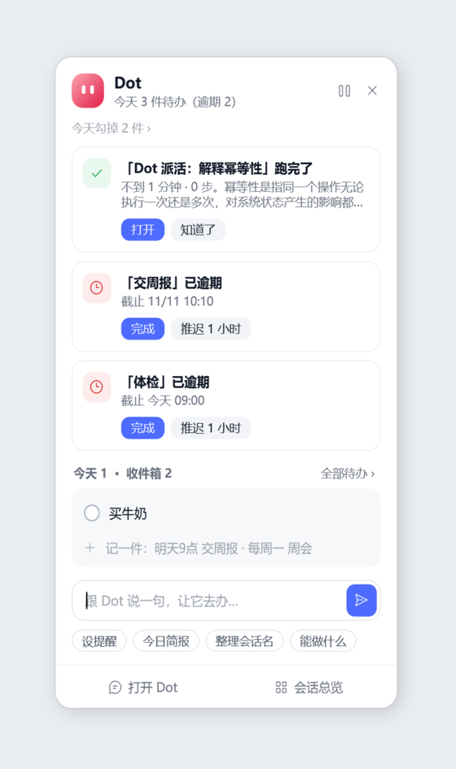
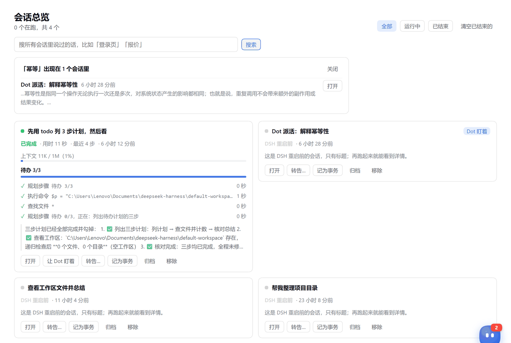
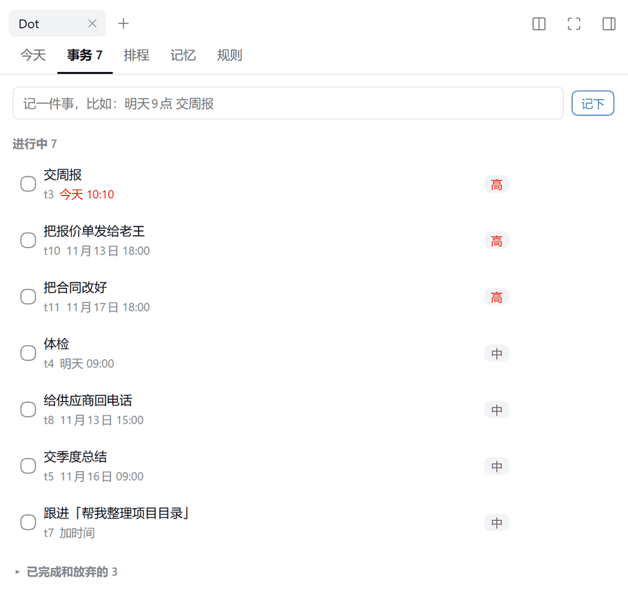
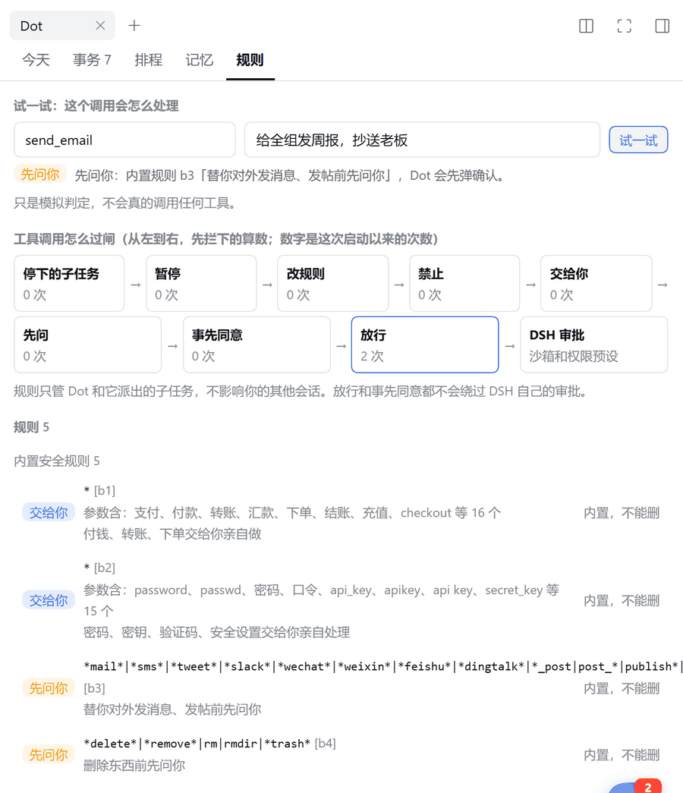
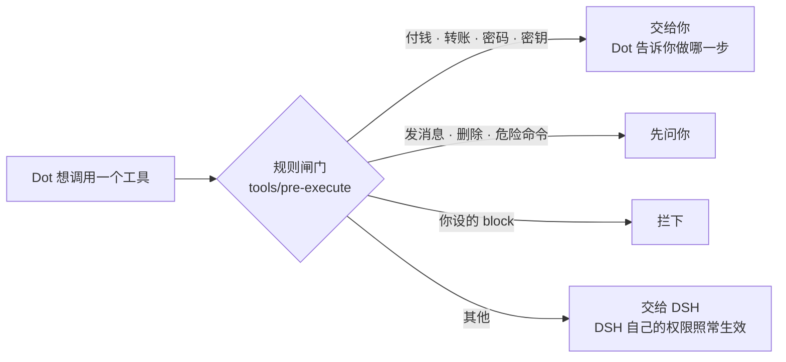
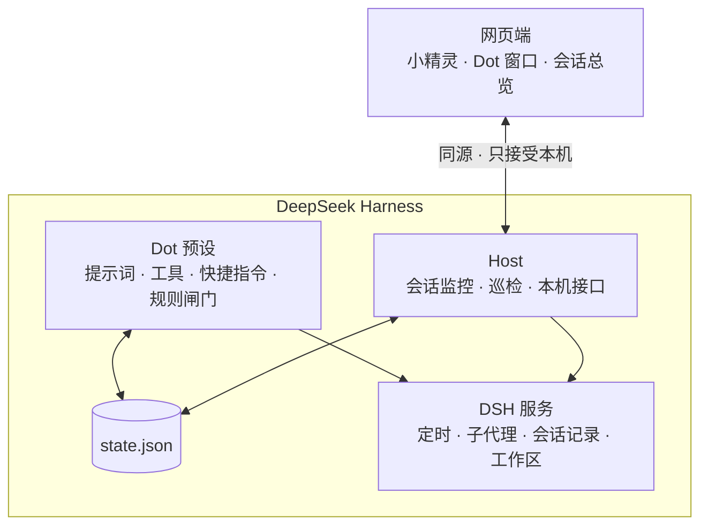

<div align="center">

# Dot 总管

**给 DeepSeek Harness 配一位个人总管：记得你，替你盯住每件事，管着你的一群会话。**

[](https://github.com/h958661134/dsh-plugin-dot/releases)
[](https://github.com/h958661134/dsh-plugin-dot/actions/workflows/test.yml)
[](https://github.com/deepseek-ai/deepseek-harness)
[](https://nodejs.org)
[](LICENSE)

[快速开始](#快速开始) · [界面一览](#界面一览) · [怎么跟它说话](#怎么跟它说话) · [安全模型](#安全模型) · [常见问题](#常见问题) · [功能参考](docs/FEATURES.md) · [English](README.en.md)



</div>

## 为什么要有 Dot

用 DSH 干活久了，事情会散在各处：这个会话里说过的截止时间、那个会话跑到一半在等你批准、三天前聊过的方案找不到了、侧栏越来越长。

Dot 是一个 DSH 插件。装上后会多出一个「Dot 总管」预设和一只小精灵：

- 你随口说的事，它当场记下、到点提醒、做完销账。
- 你开着的一群会话，它帮你看着：谁跑完了、谁卡住了、谁在等你，都会主动告诉你。
- 凡是替你开口、花钱、对外、改动不可逆的事，它只起草，你点了才算。

灵感来自 ChatGPT Dots。所有数据只存在本机。

## 核心理念

| | 理念 | 具体做法 |
|---|---|---|
| 1 | **先办，再用一句话汇报** | 「周五前把报价单发给老王」：一次工具调用就记下事务、截止时间、提醒，然后回一句「记下了：t3 周五 18:00，到点提醒你」。缺的信息用默认值补上，不追问 |
| 2 | **能不花 token 的就不花** | `/task` `/done` `/every` 等快捷指令在本地执行，能听懂「周五18点」「30分钟后」「工作日」这类中文时间。每分钟一次的巡检是纯本地规则，不调模型 |
| 3 | **替你开口的事，一律你点了才算** | 付钱、密码交给你亲自做；发消息、删除、危险命令先问你；转告、派活、归档只出一张卡。这些由代码里的规则闸门强制，不靠提示词自觉 |
| 4 | **把每个会话当成在干活的同事** | 看、盯、搜、读、转告、派活、收纳：Dot 是你的会话调度台 |
| 5 | **越用越懂你** | 你纠正一次「以后先给结论」，它就记一条「工作偏好」，以后每一步都照着做 |

## 快速开始

**要求**：DeepSeek Harness `>=0.2.0-rc.0 <0.3.0`，Node.js 22 以上（DSH 自带）。不需要额外的 API key，Dot 用的是你在 DSH 里已经配好的模型。

**1. 下载**

```bash
git clone https://github.com/h958661134/dsh-plugin-dot.git
```

也可以在 [Releases](https://github.com/h958661134/dsh-plugin-dot/releases) 下载源码压缩包并解压。

**2. 安装到 DSH**

```bash
dsh plugin --profile web add ./dsh-plugin-dot
```

桌面版用户可以在 DSH 的「插件」页面添加这个目录。命令行里，桌面版的 `dsh` 在安装目录下的 `resources/runtime/cli/bin/dsh.cmd`。

**3. 完全退出 DSH 再打开**

只关窗口不够，要从托盘或任务管理器里退出。重新打开后：

- 新建会话时，「Agent 预设」菜单里有 **Dot 总管**；
- 窗口右下角出现小精灵；
- 左侧栏多一个「会话总览」入口。

**4. 跟它说第一句话**

选中 Dot 总管，随便说一件你这周要办的事，比如「周五前把报价单发给老王，到时候提醒我」。第一次见面时，Dot 会在回复末尾介绍自己，并问你要不要每天早上 9 点发简报。

## 界面一览

### 对话：一句话落地

你说一句话，Dot 一次调用就记下事务、提醒和偏好。每一轮回复下面有一张小卡片，列出这一轮记下了什么，可以直接点完成或改时间（见上方大图）。

### 小精灵：只在需要你的时候出声

<table>
<tr>
<td width="42%"></td>
<td>

在 DSH 桌面版（Windows）里，小精灵常驻在**桌面**上：始终置顶，DSH 最小化了也看得见；拖到屏幕边缘会吸附，并缩进去只露出一小条。它仍然是插件的一部分，不用另外安装，DSH 退出时它也跟着退出。其他环境里，小精灵在 DSH 页面的右下角。

- **六种状态**：空闲、在忙、等你确认、刚做完、有事提醒（逾期、快到期、子任务卡住）、暂停。
- **只放「需要你」的卡**，最多 3 张。比如某个会话跑完了，可以「打开」或「知道了」；某件事逾期了，可以「完成」或「推迟 30 分钟」。
- **一行快捷输入**，`/task` 之类的指令也能用。在任何地方按 **Alt+Shift+D** 都能打开它。
- 点卡片上的「打开」「去处理」，会把 DSH 拉到前台并直接跳到那个会话。
- DSH 不在前台时，同时发系统通知。

</td>
</tr>
</table>

### 会话总览：你的会话调度台



左侧栏「会话总览」打开整页，每个其他会话一张卡：

- **看**：状态、用时、待办进度、最近几步、改了哪些文件、上下文用量，以及卡在哪（审批、提问、出错）。
- **搜**：顶部搜索框能搜所有会话里说过的话，包括 24 小时以前的会话；点结果直接打开。
- **管**：每张卡上可以打开、停止、让 Dot 盯着（结束时通知你并附总结）、转告一句话、记为事务、归档（可撤销）。

### Dot 窗口：事务、排程、记忆、规则

<table>
<tr>
<td width="50%"></td>
<td width="50%"></td>
</tr>
<tr>
<td><b>事务</b>：点标题改名，点时间改期，点优先级切换。派给子代理的活挂在对应事务下面，能看到进度</td>
<td><b>规则</b>：「试一试」填一个工具名和参数，看 Dot 会放行、先问你还是交给你。下面是闸门流程、每条规则和它拦过几次</td>
</tr>
</table>

打开 Dot 会话时，右侧栏会自动展开 Dot 窗口，一共五页：今天、事务、排程、记忆、规则。

## 怎么跟它说话

不用记格式，像跟助理说话一样就行：

| 你说 | Dot 做 |
|---|---|
| 「下周二前把合同改好，提前一天提醒我，这事很急」 | 记一件高优先级事务，截止下周二，周一另建一条提醒 |
| 「我不喝咖啡，开会别约在午饭后」 | 记两条长期记忆，以后安排事情时会参考 |
| 「报价单发了」 | 找到那件事务标为完成，提醒一并删除 |
| 「老王还没回」 | 事务改为「等待中」，写明在等谁 |
| 「今天有什么事？」 | 出简报：今天要办的、逾期的、在等的、派出去的，以及其他会话最近做了什么 |
| 「帮我调研三家竞品的定价，整理成表」 | 记一件事务，派给子代理去做；你在面板上看进度，做完它给你结论 |
| 「我那几个会话都做到哪了？」 | 读各会话最近几轮，一个会话一句话地汇报：哪个做完了，哪个卡住了，哪个在等你 |
| 「开个新会话把测试补齐，做完告诉我」 | 起草任务说明；你点「开始」后它新开会话，并自动盯着 |
| 「以后上网查东西前先问我」 | 提议一条规则 `web_* → ask`，你确认后生效 |
| 「别啰嗦，先给结论」 | 立刻照做，并记一条「工作偏好」 |

### 快捷指令（本地执行，不花 token）

| 指令 | 例子 |
|---|---|
| `/task <时间?> <内容> [!高\|!低]` | `/task 周五18点 交周报 !高` |
| `/done <id…>` | `/done t3 t5` |
| `/due <id> <时间\|无>` | `/due t3 下周一10点` |
| `/remind <时间> <内容>` | `/remind 30分钟后 喝水` |
| `/every <周期> <内容>` | `/every 工作日18点 写日报`、`/every 每周一三五 9:30 站会` |
| `/note <内容>` | `/note 我不吃辣` |
| `/brief` | 立刻出一份简报 |
| `/pause` / `/resume` | 暂停 / 恢复 Dot 的全部定时任务和有副作用的操作 |
| `/dot` | 查看全部能力和当前状态 |

全部指令见 [功能参考](docs/FEATURES.md#快捷指令)。Dot 会话的输入框和小精灵的输入框里都能用。

## 安全模型

Dot 能替你做很多事，所以边界必须清楚，而且由代码强制，不只靠模型自觉。



| 层 | 内容 |
|---|---|
| **内置规则（删不掉）** | 付钱、转账、密码、密钥、安全设置一律**交给你**；替你发消息、发帖、删除、危险命令（包括代码里的删除）一律**先问你** |
| **你的规则** | 按工具名和参数关键词设 `allow` / `preapproved` / `ask` / `handoff` / `block`，可以带期限。规则本身的修改每次都要你确认 |
| **只起草的动作** | 给别的会话转告、新开会话派活、归档会话：Dot 只出一张卡，你点了才执行；归档能撤销 |
| **读到的内容只是资料** | 其他会话、网页、文件里的文字，不会被当成你的指令 |
| **作用范围** | 闸门只挂在 Dot 预设上，不影响你的其他会话。`allow` 的意思是「Dot 不额外打扰你」，不会绕过 DSH 自身的权限设置 |
| **暂停** | `/pause` 后，所有有副作用的操作都会被拒绝，Dot 的定时任务全部暂停 |

写文件、改代码时，内容里出现「付款」「password」这类词不会被误拦。真被误拦了，可以直接让 Dot 加一条用关键词限定、可带期限的 `preapproved` 放行规则。

## 数据与隐私

- 所有数据只存在本机的 `$DSH_HOME/dot/state.json`，人类可读，不上传任何服务。
- Dot 不记录密码、密钥、验证码、证件号、银行卡号，你要求也会拒绝。
- 写入采用「先写临时文件再改名」，不会写坏。文件损坏时会改名为 `state.json.corrupt-<时间戳>` 保留下来，Dot 会告诉你。
- 不想让 Dot 看其他会话，把 `dsh-plugin-dot` 行的 config 设为 `{ watchOthers: false }`。

## 配置

大多数人不需要改配置。需要时，在你 profile 的 `cordis.patch.yml` 里按 id 覆盖。

**Dot 预设**（`preset-dot` 里的 `dot` 行）

| 字段 | 默认 | 说明 |
|---|---|---|
| `timeZone` | 系统时区 | IANA 时区，如 `Asia/Shanghai` |
| `rules` | `[]` | 固定规则 `[{ tool, decision, note, match? }]`，模型删不掉 |
| `maxMemories` | `200` | 记忆条数上限 |
| `contextMemoryLimit` | `40` | 每步带进上下文的记忆条数 |
| `contextTaskLimit` | `15` | 每步带进上下文的事务件数 |
| `guide` | `true` | 是否注入「Dot 工作手册」提示词 |
| `dataDir` | `$DSH_HOME/dot` | 数据目录（绝对路径） |

```yaml
- id: dot
  name: dsh-plugin-dot/agent
  config:
    timeZone: Asia/Shanghai
    rules:
      - { tool: pwsh, decision: ask, note: 执行命令前先问我 }
```

Loader 会整体替换 `config`，所以要把整个 preset 定义复制过去再改。

**全局行**（`dsh-plugin-dot` 行）

| 字段 | 默认 | 说明 |
|---|---|---|
| `pet` | 桌面版（Windows）为 `'desktop'`，其他为 `true` | `'desktop'` 用桌面精灵，`true` 只用 DSH 页面里的小精灵，`false` 都不要 |
| `watchOthers` | `true` | `false` 时不监控其他会话 |

桌面精灵的原理和安全说明见 [docs/DESKTOP-PET.md](docs/DESKTOP-PET.md)。

## 常见问题

<details>
<summary><b>装好了，但「Agent 预设」里没有 Dot 总管？</b></summary>

DSH 只在启动时加载插件。请完全退出 DSH（从托盘退出，或在任务管理器里结束进程）再打开。还不行的话，运行 `dsh plugin --profile web list`，看插件是否装进了你正在用的 profile。
</details>

<details>
<summary><b>会多花很多 token 吗？</b></summary>

在 Dot 会话里，每一轮固定多出约 2.5k token：工作手册约 1.8k，工具说明约 0.7k。手册内容固定，能命中 KV 缓存，实际开销更低。快捷指令、巡检、小精灵、会话总览都在本地运行，不花 token。其他会话不受影响。
</details>

<details>
<summary><b>会影响我的其他会话吗？</b></summary>

规则闸门和工作手册只挂在 Dot 预设上。对其他会话，Dot 只读状态，显示在会话总览里；只有你点了按钮，它才会执行停止、转告、归档这类动作。不想让它看其他会话，设 `watchOthers: false`。
</details>

<details>
<summary><b>桌面精灵是怎么做到的？会不会是个独立程序？</b></summary>

DSH 不允许插件直接开桌面窗口，所以 Dot 的 Host 用 Windows 自带的 PowerShell + WPF 启动一个小窗口，并全程管着它：DSH 退出它就退出，崩了自动拉起，你在右键菜单里关掉的不会再出现。它只连 Dot 自己的本机接口，能做的事和 DSH 页面里的小精灵一样。不想要就设 `pet: true`。详见 [docs/DESKTOP-PET.md](docs/DESKTOP-PET.md)。
</details>

<details>
<summary><b>系统通知没弹出来？</b></summary>

系统通知要求至少开着一个 DSH 页面（桌面版窗口或浏览器标签）。全部关掉时，通知会留在小精灵里，等你下次打开再看。
</details>

<details>
<summary><b>Dot 拦了一个不该拦的操作怎么办？</b></summary>

直接跟它说「这类操作以后不用问我」，它会提议一条用关键词限定的 `preapproved` 规则，你确认后生效。也可以在 Dot 窗口的「规则」页用「试一试」，看某个调用会被怎么处理。
</details>

<details>
<summary><b>数据想备份或迁移？</b></summary>

复制 `$DSH_HOME/dot/state.json` 就行，它是普通的 JSON 文件。
</details>

## 工作原理

<details>
<summary>展开看架构</summary>

Dot 是一个标准的 Cordis 插件 bundle，分两部分：

- **Dot 预设**（`dsh-plugin-dot/agent`）：注册「Dot 总管」agent 预设。包括工作手册提示词、7 个工具（`dot_capture` `dot_tasks` `dot_memory` `dot_rules` `dot_brief` `dot_suggest` `dot_sessions`）、快捷指令，以及 `tools/pre-execute` 规则闸门。
- **全局 Host**（`dsh-plugin-dot`）：在 DSH 进程里监听会话和子代理事件，每分钟本地巡检一次，提供本机 HTTP 接口，并向网页端注入小精灵、Dot 窗口和会话总览。



- 提醒和周期任务直接建在 DSH 的定时服务上，和 DSH 自己的「自动化任务」是同一套。
- 搜会话优先用 DSH 的全文索引，索引没开时逐个扫描最近 30 天的会话。
- 运行时不依赖任何 `@deepseek-ai/*` 包。纯 JavaScript ESM 加 `@ts-check`，不需要构建。

代码结构和 Host 接口见 [功能参考](docs/FEATURES.md#代码结构)，设计取舍见 [docs/](docs/) 里的各版设计文档。
</details>

## 路线图

- [x] 记事、提醒、长期记忆、规则闸门、简报
- [x] 小精灵、Dot 窗口、子任务监控
- [x] 建议收件箱、从纠正里学偏好
- [x] 会话调度台：搜索、读档、转告、派活、收纳
- [ ] 按项目（工作目录）分组的会话视图
- [ ] 周报：这周各会话、各项目做了什么
- [ ] 英文界面

想要什么功能，欢迎 [提 issue](https://github.com/h958661134/dsh-plugin-dot/issues/new/choose)。

## 参与开发

```bash
git clone https://github.com/h958661134/dsh-plugin-dot.git
cd dsh-plugin-dot
npm test        # 123 个测试，用 node:test，不需要装依赖
```

开发时建议用一个隔离的 `DSH_HOME` 起一个网页版 DSH 来试，不要动你日常用的 profile。详见 [CONTRIBUTING.md](CONTRIBUTING.md)。

## 致谢

- [DeepSeek Harness](https://github.com/deepseek-ai/deepseek-harness) 提供了插件、定时、子代理、会话记录这些扎实的扩展点。
- 产品灵感来自 ChatGPT Dots。

## License

[MIT](LICENSE)
