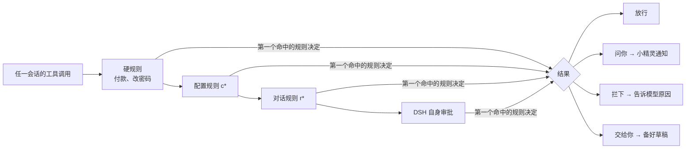

# Dot 重新规划：三个界面 + DSH API 盘点 + 规则可视化

> 取代 [DESIGN-v0.4.md](DESIGN-v0.4.md) 第二部分的旧路线图（旧的 v0.4a/b/c 已并入下文）。
> API 盘点依据 DSH 0.2.2-rc.1 源码（`docs/capability-seams`、各 client 包 README）以及对已安装 `app.asar` 的检索。

## 一、设计目标

用户每次瞥一眼，每个界面只回答一个问题：

| 界面 | 回答的问题 | 形态 |
|---|---|---|
| **小精灵** | 「现在有没有要我管的事？」 | 悬浮在所有页面，只做快捷操作和状态通知 |
| **Dot 窗口** | 「我交给 Dot 的所有事怎么样了？」 | Dot 会话（中间对话）+ 右栏「Dot」标签页，完整功能 |
| **会话总览** | 「别的会话各自在干什么、卡在哪？」 | 左侧栏入口打开的整页，每个会话一张详情卡 |

三者共用宿主侧同一份状态（`hub` + `store`），区别只在展示什么、能做什么。

### 现在的问题

- 小精灵面板里有「进行中 / 已排程 / 已完成 / 其他会话」四个列表，承担了完整功能，弹窗太挤；其他会话只有一行状态，看不出具体在做什么。
- Dot 的对话（DSH 会话）和事务管理分在两个地方，管理只能靠小精灵弹窗或斜杠指令。

## 二、三个界面的分工

### 小精灵：只做这些

| 内容 | 说明 |
|---|---|
| 表情和气泡 | 按状态优先级挑一个（见第四部分「状态优先级」） |
| 「需要你」通知卡（最多 3 张） | 审批 / 提问 / 计划待审 → **去处理**；提醒到点 → **完成 / 推迟 10 分钟**；子任务或被盯着的会话完成、出错 → **打开 / 知道了** |
| 建议角标 | 「我有 2 个建议」，点了打开 Dot 窗口的「今天」页 |
| 一行快捷输入 | 发给 Dot；也接受 `/task` `/remind` `/note` `/pause` 等快捷指令，结果用气泡回一句 |
| 暂停 / 恢复 | 一个按钮 |
| 系统通知 | DSH 窗口不在前台时，「需要你」类事件同时发系统通知 |
| 两个入口 | 打开 Dot 窗口、打开会话总览 |

**从小精灵移走**：四个列表页、事务编辑、排程管理、已完成记录、其他会话列表 → 分别搬到 Dot 窗口和会话总览。小精灵弹窗从「列表」变成「通知卡 + 输入框 + 两个入口」。

### Dot 窗口：完整功能

打开 Dot 会话时，右栏自动打开「Dot」标签页（`sidebar.right.pane.tab`）。中间是 DSH 原生的对话，右边是管理面板，两边同时可用。

| 标签 | 内容 |
|---|---|
| 今天 | 简报、今天到期、逾期、建议收件箱（采纳 / 忽略） |
| 事务 | 进行中 / 已完成 / 已放弃；行内改标题、时间、优先级；展开看子任务树 |
| 排程 | 提醒和周期任务，暂停 / 删除 / 立即运行 |
| 记忆 | 查看、删除、标记「工作偏好」 |
| 规则 | 规则流程图、每条规则的命中次数和最近命中、「试一试」 |

对话里另加两种卡片（`conversation.chat.turnTail`）：Dot 建了事务时显示事务卡（完成 / 改时间），Dot 给出建议时显示建议卡（采纳 / 忽略）。

### 会话总览：其他会话的工作详情

左侧栏注册入口（`sidebar.panellist`），整页显示（`main` 面板）。每个会话一张卡，Dot 自己的会话不在这里：

| 卡片字段 | 数据来源 |
|---|---|
| 标题、状态、用时、当前步骤 | 已有：`agent/status`、`tools/pre-execute` |
| 待办进度「3/7 · 正在：写测试」 | 新增：捕获该会话的 `todo_write` 调用参数 |
| 最近 5 步工具时间线（工具 + 摘要 + 耗时） | 已有事件，改为保留最近 N 步 |
| 卡在哪：等审批 / 等回答 / 等审计划 / 出错 | `approval/request`、`ask_user` 工具、计划模式状态、`agent/error` |
| 改了哪些文件 | `workspace/changes` 事件 / `ctx.workspaceChanges` |
| 后台任务（还在跑的命令） | `ctx.jobs.list` / `events.subscribe` |
| 子代理树 | 已有 `subagent/*` + `sessionQuery.traceSession` |
| 目标、上下文用量 | `ctx.goals.get(agent)`、`ctx.tokenMeter.measure(session)` |
| 最后一句回复（截断） | 会话的助手消息事件 |

卡片操作：**打开**、**停止**、**让 Dot 盯着**（完成或出错时通知并总结一句）、**记为事务**、**移除**。

DSH 重启后，用 `ctx.sessionQuery` 回读当天的会话补齐卡片，解决「运行记录只在内存里」的问题。

## 三、DSH API 盘点

「放在哪」：精 = 小精灵，窗 = Dot 窗口，总 = 会话总览，后 = 宿主后台（无界面）。

### 已经在用

| API | 用途 | 放在哪 |
|---|---|---|
| `agent/status`、`agent/error` 全局事件 | 根会话、子任务、其他会话的状态 | 后 |
| `tools/pre-execute`、`tools/result` | 当前步骤、规则闸门 | 后 |
| `approval/request` waterfall | 「待你决定」 | 精 |
| `subagent/start`、`subagent/end`、`ctx.subagents.interrupt` | 子任务跟踪与停止 | 窗 |
| `agent.cancel` | 停止其他会话 | 总 |
| `ctx.sessionTitle` | 会话标题 | 总 |
| `ctx.schedule` | 提醒、简报 | 窗 |
| `ctx.commands` | `/task` 等斜杠指令 | 窗 |
| `ctx.agentPresets`、`ctx.systemPrompt` | Dot 预设与提示词 | 后 |
| `ctx.webServer` | 小精灵用的 HTTP 路由 | 后 |
| 客户端 `uiWorkspace.openSession` | 跳到会话 | 精 / 总 |

### 计划接入

| API | 能拿来做什么 | 放在哪 | 版本 |
|---|---|---|---|
| 客户端 slot `main` + `sidebar.panellist` | 会话总览整页 + 左侧栏入口 | 总 | v0.4 |
| 客户端 `sidebarRightTabs` + slot `sidebar.right.pane.tab` | Dot 窗口右栏面板 | 窗 | v0.4 |
| 客户端共享模块 `react`、`dsh-client-ui-primitives` | 写面板，外观和 DSH 一致（插件可直接 `require`） | 窗 / 总 | v0.4 |
| `todo_write` 调用参数 | 其他会话的待办进度 | 总 | v0.4 |
| `ask_user` 工具 / `ctx.userQuestions` | 「等你回答」通知 | 精 / 总 | v0.4 |
| `ctx.planMode` | 「等你审计划」 | 精 / 总 | v0.4 |
| `ctx.jobs` | 后台任务列表；长任务跑完通知 | 总 / 精 | v0.4 |
| `ctx.workspaceChanges` | 每个会话改了哪些文件 | 总 | v0.4 |
| `ctx.sessionQuery` | 重启后回读当天会话；简报汇总今天做了什么 | 总 / 窗 | v0.4 |
| 浏览器 `Notification` | 窗口不在前台时的系统通知 | 精 | v0.4 |
| 客户端 slot `conversation.approval.detail` | 审批卡上写明「因为 Dot 规则 r2 要求先问」 | 规则可视化 | v0.5 |
| 客户端 slot `conversation.chat.turnTail` | Dot 对话里的事务卡、建议卡 | 窗 | v0.5 |
| `ctx.goals` | 会话卡显示目标和轮次 | 总 | v0.5 |
| `ctx.tokenMeter` | 上下文用量条，快满时提醒 | 总 | v0.5 |
| `ctx.schedule` 的 run / 全量 list | 排程「立即运行」；只读查看非 Dot 的定时任务 | 窗 | v0.6 |
| `ctx.messageFeedback` / `sessionFeedback` | 你点踩或纠正时记成工作偏好 | 后 | v0.7 |
| `ctx.settings`（插件配置表单） | 在 DSH 设置页改：是否监控其他会话、简报时间、通知开关 | 设置页 | v0.7 |
| 客户端 `shortcuts` | 全局快捷键：唤起小精灵输入框 | 精 | v0.7 |
| 客户端 slot `sidebar.workspaces.session.row.action`、`contextMenus` | 侧栏会话行上的「让 Dot 盯着」 | 总 | v0.7 |
| `ctx.agentTeams` | 团队任务 DAG 视图 | 总 | 待定 |
| `ctx.workflowEngine` | 周期任务跑多步流程 | 窗 | 待定 |

### 不做

| API | 原因 |
|---|---|
| `ctx.approval` 代答 | 审批由 DSH 界面回答，插件代答会绕过用户；只做「去处理」跳转 |
| `computerUse` / `browserUse` / `ssh` / `lsp` / `terminals` / `sandbox` | 执行能力属于干活的会话，Dot 只派活和盯进度 |
| `credentials` / `deepseekAccount` / `authorization` | 不碰账号和凭据 |
| `mcpManager` / `pluginManager` / `configEditor` | 不替用户改 DSH 配置 |
| `storage` / `storageDomain` | `state.json` 够用，迁移收益小 |
| `webhookRuntime`、`claudeCodeMods` | 已安装的 0.2.2 里检索不到，等正式提供再看 |
| 遥测、`inspector`、`hmr` | 与功能无关 |

## 四、把抽象规则可视化

Dot 里有四类「看不见的规则」，每类都要在界面上看得到：

### 1. 规则闸门（会话里的工具能不能执行）

- **规则页**：上面这张流程图是真实的界面，每个闸门显示条数；点开是规则卡（来源、条件、动作、命中次数、最近命中的会话）。
- **试一试**：输入工具名或命令，高亮出会命中的那条规则和结果，不真正执行。
- **审批卡**：规则要求「问你」时，在 DSH 自己的审批卡上加一行「因为 Dot 规则 r2 要求先问」。
- 每次命中写一条命中记录（规则、会话、工具、结果、时间）。

### 2. 委派规则（Dot 什么时候派子任务）

现在只写在提示词里。规则页加一张只读卡片，列出：什么情况必须派、子任务怎么命名、停下的子任务不能自己续上。Dot 每次委派时，事务卡上标注依据哪条规则。

### 3. 通知路由（事件去哪里）

| 事件 | 小精灵气泡 | 通知卡 | 系统通知 | 只在窗口里 |
|---|---|---|---|---|
| 审批 / 提问 / 计划待审 | ✓ | ✓ | ✓ | |
| 提醒到点 | ✓ | ✓ | ✓ | |
| 子任务或被盯着的会话出错 | ✓ | ✓ | ✓ | |
| 子任务或被盯着的会话完成 | ✓ | ✓ | 可选 | |
| 其他会话跑完（未盯着） | ✓（一闪） | | | ✓ |
| 新建议 | 角标 | | | ✓ |
| 事务增删改 | | | | ✓ |

这张表本身也放在规则页，可以逐行开关。

### 4. 小精灵状态优先级

暂停 > 等你确认 > Dot 在忙 > 子任务在忙 > 其他会话在忙 > 一闪而过的消息 > 卡住 > 逾期 > 快到期 > 空闲。规则页用一条从高到低的阶梯展示，当前生效的那一级高亮，回答「它为什么是这个表情」。

## 五、新路线图

旧计划怎么并进来：旧 v0.4a 主动性 → v0.6；旧 v0.4b 规则与安全 → v0.5（加上可视化）；旧 v0.4c 打磨 → v0.7。先做三个界面，因为建议收件箱、规则页、会话详情都需要一个放的地方。

### v0.4 三个界面（已完成，0.4.0）

> 进度（2026-11-11）：任务 0–6 全部完成，76 个单测通过，在隔离的真实 DSH 上逐项操作验证过。
> 和原计划的两处不同：
> - **没有加构建步骤**（原任务 1）：面板直接用 DSH 共享的 `react` 写成 `React.createElement`，放在 `lib/bridge.js` 里，插件保持零依赖。
> - **系统通知的路由先做成固定规则**，在 Dot 面板「规则」页展示，逐行开关留到 v0.5。
>
> 风险验证结果：手写 loader 包能注册 `main` 整页、`sidebar.panellist` 入口和右栏标签 ✓；`todo_write` 参数在 `tools/pre-execute` 的 `exec.arguments` 里 ✓；`ctx.sessionQuery` 能在重启后补回会话 ✓。
> 新发现：从界面新建的 Dot 会话，会话记录的 header 里没有 `agentPreset`，所以 Host 自己记住用过的 Dot 会话（`dot-sessions.json`），重启后「打开 Dot」也能找到。

| # | 任务 | 完成标准 |
|---|---|---|
| 0 | **技术验证**：手写 loader 格式的客户端模块，`require('react')` 注册 `main` 面板、`sidebar.panellist` 入口和右栏标签 | 隔离的 DSH 上看到左侧栏入口、整页和右栏标签各一个「你好」 |
| 1 | 客户端构建：`src/ui/*.jsx` 用 esbuild 打包成 loader 格式（`react` 等保持 external） | `npm run build` 生成 `lib/ui.js`，测试里能加载 |
| 2 | 宿主：会话详情采集（待办、最近 N 步、卡点、改动文件、后台任务、最后回复）+ `/sessions` 路由 + 重启后用 `sessionQuery` 回读 | 单测覆盖；隔离 DSH 上另开会话跑 `todo_write`，详情里能看到 |
| 3 | 会话总览整页 | 卡片字段齐全；打开 / 停止 / 让 Dot 盯着 / 记为事务 / 移除都能用 |
| 4 | Dot 窗口右栏面板（今天 / 事务 / 排程 / 记忆，规则页先放列表） | 打开 Dot 会话自动出现；小精灵原有的列表功能全部能在这里做 |
| 5 | 小精灵瘦身：通知卡 + 快捷输入 + 两个入口；「让 Dot 盯着」的完成和出错通知 | 弹窗里不再有列表；每张通知卡一键处理 |
| 6 | 系统通知 + 通知路由表 | 窗口最小化时审批和提醒能弹出系统通知 |

### v0.5 规则可视化与安全

- 规则页：闸门流程图、规则卡、命中记录、试一试、状态优先级阶梯、通知路由开关。
- 审批卡加「因为哪条规则」。
- 内置硬规则（付款、改密码或账户安全设置、对外发消息：一律先问或交给你，模型删不掉）。
- 新动作：`preapproved`（用户本轮原话明确要求过才放行）、`handoff`（不执行，备好草稿交给你）。
- Dot 对话里的事务卡、建议卡。
- 会话卡加目标和上下文用量。

> **已完成（0.5.0）**，与原计划的差别：
> - **内置硬规则** b1–b5：付钱和密码类交给你（handoff）；发消息、删除、危险命令先问（ask）。规则匹配工具名，也匹配参数关键词。Dot 自己的账本、只读工具和给子代理派活不受影响，不然「记一件事：周五付款」也会被拦下。
> - **`preapproved` 改成持久规则**：你说「给老板发周报不用问」，加一条带关键词的 preapproved 规则，它只能抵消内置的「先问」，抵消不了 handoff。原计划是「本轮原话要求过才放行」，但闸门看不到本轮原话，没法可靠判断，所以改了。
> - **handoff 不备草稿**：调用被拒，Dot 被要求告诉你要亲自做哪一步，小精灵和 Dot 窗口出一张「交给你」通知卡。
> - **审批卡说明没做成 slot**：`conversation.approval.detail` 是单例槽位，DSH 自己的 ApprovalCommand 已经占用，注册会把命令详情顶掉。改为把规则 id 和说明写进审批理由（`displayReason`），审批卡上显示「按 Dot 规则 r2「…」，调用 pwsh 前需要你确认」。
> - **命中记录只在内存里**，DSH 重启清零。
> - **通知路由**：每类事件都能开关，存在 `state.json` 的 `prefs.routes` 里，只存与默认不同的项。审批、提问和「交给你」的通知卡锁定不能关。子任务、其他会话结束只有气泡。
> - **没做的**：对话里的事务卡、建议卡（turnTail），以及会话卡上的上下文用量。都挪到 v0.6。会话卡上的目标在 v0.4 已经有了。

### v0.6 主动性

- 首次使用自动建「每天 9:00 简报」，简报用 `sessionQuery` 汇总昨天各会话做了什么。
- `/every` 周期任务。
- 只读巡检预设 `dot-patrol` 产出建议，进「今天」页的建议收件箱。
- 「让 Dot 盯着」升级：会话结束时总结它做了什么、改了哪些文件。

> **已完成（0.6.0）**，与原计划的差别：
> - **每日简报改成建议，不自动建**：没征得同意就建定时任务，等于替你花 token。现在巡检发现还没有简报，就在建议收件箱里问一句，可选 9 点或 8 点半，点了才建。简报里新增「最近 24 小时的其他会话」和「待你看的建议」。
> - **巡检不另开 `dot-patrol` 预设**：改为 Host 里每分钟一次的本地规则检查，不调用模型、零 token、天然只读。目前有四条规则：没有每日简报、逾期超过一天、等待超过三天、其他会话出错没人盯。要靠模型判断的建议走 `dot_suggest` 工具，由 Dot 在对话里顺手提出。
> - **建议收件箱**：同一件事不重复提；采纳或忽略后 7 天内不再提；情况变了自动收起；最多保留 20 条未处理的。采纳动作有六种：建每日简报、改期、放弃、记为事务、建提醒、交给 Dot 去做（最后一种需要有打开的 Dot 会话）。
> - **`/every`**：直接用 DSH 定时服务的 daily / weekly / every，不经过模型。
> - **盯着的会话结束总结**：通知里写用时、步数、改了哪些文件和最后一句回复。
> - **还没做，挪到 v0.7**：对话里的事务卡和建议卡（turnTail）、会话卡上的上下文用量。

### v0.7 打磨

- 从点踩和纠正里学工作偏好。
- DSH 设置页里的插件配置表单。
- 全局快捷键唤起小精灵输入框；侧栏会话行和右键菜单里的「让 Dot 盯着」。
- 名字和外观。

> **已完成（0.7.0）**，与原计划的差别：
> - **对话里的事务卡、建议卡**：挂在 `conversation.chat.turnTail`，用这一轮的起止时间去 Host 查这一轮在这个会话里建的事务（事务新增 `createdIn` 字段记录在哪个会话建的）和 Dot 提的建议。只在 Dot 会话、而且这一轮已结束时查。
> - **从纠正里学偏好**：没有做「点踩」入口，DSH 没开放消息反馈的事件。改为在工作手册里要求 Dot 遇到纠正就记一条「工作偏好：」开头的记忆，这类记忆总是带进上下文（最多 20 条），不受记忆条数上限挤占。
> - **侧栏会话行的「让 Dot 盯着」**：挂在 `sidebar.workspaces.session.row.action`。右键菜单没有对外开放的插槽，所以没做。
> - **全局快捷键**：只在 DSH 窗口里有效，是 Alt+Shift+D。Alt+D 会被浏览器抢去聚焦地址栏。系统级全局快捷键需要桌面壳支持，插件做不到。
> - **名字和外观**：可以改名字，有 6 种颜色，存在 `prefs.pet` 里。
> - **会话卡上的上下文用量**：用 `tokenMeter.contextPressure`，只有加载过的会话才有数据。
> - **DSH 设置页的配置表单：不做**。表单要求插件导出 Schemastery 格式的 `Config`，本插件刻意零依赖。能在界面上改的设置（规则、通知、外观）都放在 Dot 窗口里了。

### 发布节点

建议 v0.5 完成后发布第一个公开版：三个界面加可视化规则最能体现差异。桌面置顶小精灵等系统通知上线后再评估。

## 六、要先验证的风险

| 风险 | 怎么验证 | 退路 |
|---|---|---|
| 外部插件手写 loader 包能否 `require('react')` 并注册 `main` / 右栏 slot | v0.4 任务 0 | 退回现在的独立脚本小精灵，用 DOM 自己画整页浮层 |
| `sidebar.panellist` 对外部插件的 key、图标、文案要求 | 同上 | 只用小精灵和右栏入口 |
| `todo_write` 参数在 `tools/pre-execute` 里拿得到 | 隔离 DSH 实测 | 读 `sessionProjections` 的 `todos` 投影 |
| `ctx.jobs`、`workspaceChanges` 的跨会话读取权限 | 隔离 DSH 实测 | 这两项只显示「不可用」，不影响其他字段 |
| 右栏标签在非 Dot 会话里不该出现 | `canOpen` + 只在 Dot 会话自动打开 | 标签里显示「这是 Dot 的面板」并给入口 |
